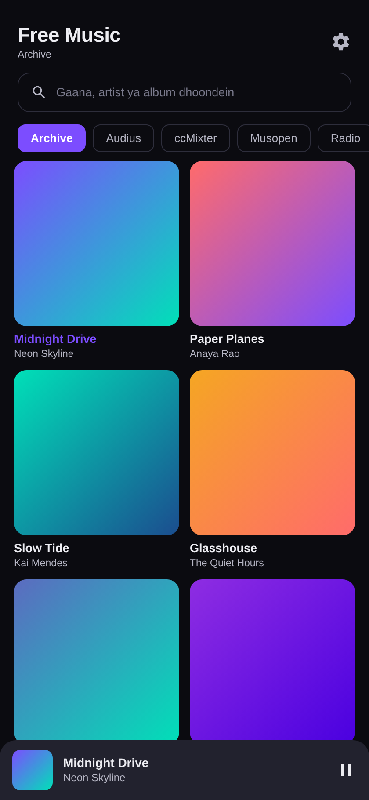
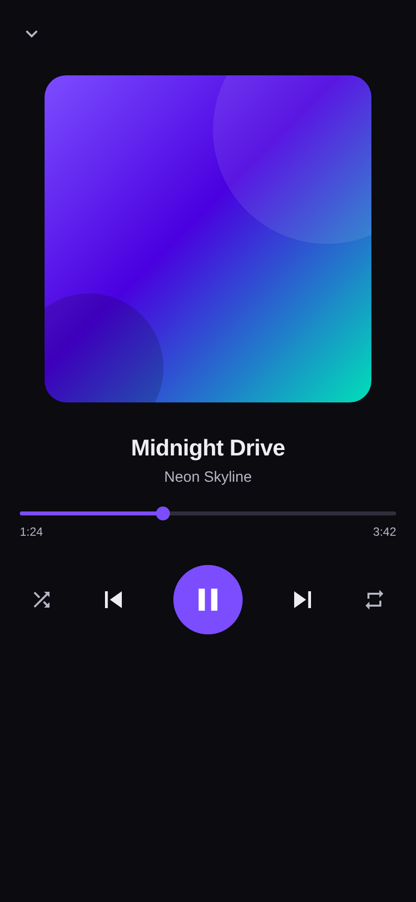

# Free Music — Android music player

Ek chhota, pura chalne wala Android music player jo **do free, keyless sources** se
chalta hai: **Internet Archive** aur **Audius**. App khulte hi album artwork ka grid
dikhta hai. Kotlin + Jetpack Compose + Media3 (ExoPlayer).

> **Legal note:** commercial catalog (Bollywood / Hollywood) kisi bhi app se free nahi
> chalaya ja sakta — uske liye licensed platform chahiye. Ye app sirf wahi music bajata
> hai jo public domain hai ya artist ne khud CC license ke saath share kiya hai.

## Screenshots

| Browse | Player | 
|---|---|
|  |  |

_Note: ye UI previews hain jo app ke actual Compose theme (colours, type scale, layout)
se banaye gaye hain — real device screenshots nahi, kyunki build environment mein
emulator nahi tha._

## Download

Prebuilt APK: [**FreeMusic-1.7.apk**](https://github.com/technicalnihilist-lgtm/free-music-player-android/releases/latest)

Install karne ke liye phone par "Install unknown apps" allow karna padega.
Debug key se signed hai — apna release build banane ke liye neeche dekhein.

## Music sources

Dono sources **bina kisi API key, bina signup, bina account** ke chalte hain.

| Source | Catalog |
|---|---|
| **Archive** (default) | Public domain aur Creative Commons **music** — netlabels, live concert recordings (etree), 78rpm transfers |
| **Audius** | Open catalog, artists ke apne uploads; trending aur search |

App khulte hi **Archive** load hota hai; upar ke chips se **Audius** par switch kar sakte
hain. Dono jagah 2-column artwork grid, tap karke bajayein.

**Archive ke baare mein:** query sirf music collections tak seemit hai — `netlabels`,
`audio_music`, `etree` (live concerts), `georgeblood`/`78rpm` — aur `librivox`,
`audio_bookspoetry`, `podcasts`, `radioprograms`, `oldtimeradio`, `audio_news` jaise
spoken-word collections explicitly exclude hain. Results downloads ke hisaab se sort hote
hain, taaki grid mein asli music aaye. Listing sasti hai, par asli MP3 ka URL har item ke
andar alag hota hai, is liye audio tap karne par resolve hota hai
(`archive.org/metadata/{id}`), phir player ko diya jaata hai.

**Audius ke baare mein:** read API mein har request par sirf ek `app_name` string jaati
hai. `GET /tracks/{id}/stream` asli audio deti hai un tracks ke liye jinme
`is_streamable` true hai. Audius kai discovery nodes par chalta hai, is liye app 4 known
hosts order se try karta hai.

## Features

- App khulte hi **album artwork ka 2-column grid**
- Do free sources: Archive aur Audius — dono keyless
- Archive par **sirf music** — speeches, audiobooks, podcasts, old radio drama aur
  personal recordings filter ho jaate hain
- Search — gaana, artist ya album ke naam se
- Background playback + notification aur lock-screen controls (Media3 MediaSession)
- Play / pause, next / previous, seek bar, shuffle, repeat-all
- Headphones nikalne par auto-pause
- Mini player + full-screen player with album art

## Build

```bash
# JDK 17 + Android SDK 34 chahiye
echo "sdk.dir=/path/to/Android/sdk" > local.properties
./gradlew :app:assembleDebug
# output: app/build/outputs/apk/debug/app-debug.apk
```

Ya Android Studio mein `File > Open` → sync → `Build > Build APK(s)`.

## Tech

| | |
|---|---|
| Language | Kotlin 1.9.24 |
| UI | Jetpack Compose (Material 3), Compose BOM 2024.06.00 |
| Playback | AndroidX Media3 1.3.1 (ExoPlayer + MediaSessionService) |
| Networking | OkHttp 4.12.0, `org.json` |
| Images | Coil 2.6.0 |
| AGP / Gradle | 8.5.2 / 8.7 |
| minSdk / targetSdk | 24 (Android 7.0) / 34 |

## Structure

```
app/src/main/java/com/freemusic/player/
  MainActivity.kt              entry point, notification permission
  data/InternetArchive.kt      archive.org music search + lazy MP3 resolution
  data/Audius.kt               Audius API (no key) + node failover
  player/PlaybackService.kt    Media3 background service + notification
  player/PlayerViewModel.kt    MediaController + UI state flow
  ui/App.kt                    Compose UI (artwork grid, mini player, player)
  ui/PlayerIcons.kt            hand-built vector icons (keeps APK small)
  ui/theme/Theme.kt            dark colour scheme
```

Kuch files repo mein padi hain par UI se hata di gayi hain: `data/Jamendo.kt`,
`data/SpotifyAuth.kt`, `data/SpotifyApi.kt`, `data/Prefs.kt`, `data/CcMixter.kt`,
`data/RadioBrowser.kt`. Ye purane releases mein chal rahe the; v1.6 mein sirf Archive aur
Audius expose hain.

## Changelog

**v1.7** — Poora naya UI: "liquid glass" design. Ambient gradient blobs, glass surfaces,
hero heading, segmented source control, gloss artwork cards with a play badge (playing
card par animated equalizer), glass mini player with a progress line, aur naya
now-playing screen. Note: Android mein true backdrop-blur nahi hota, is liye glass
translucent surfaces + gradient hairlines se approximate kiya gaya hai.

**v1.6** — Sirf Archive aur Audius (ccMixter, Musopen, Radio hata diye — wo chal nahi rahe
the). Archive ki query ab music-only hai: sirf netlabel/music/live-concert/78rpm
collections, spoken-word collections excluded, aur downloads ke hisaab se sorted. Results
60 se 100 kar diye.

**v1.5** — Paanch keyless sources: Archive, Audius, ccMixter, Musopen (archive.org ka
`musopen` collection), aur Radio Browser. Jamendo aur Spotify UI se bahar rakhe gaye.

**v1.4** — Sirf do keyless sources: Internet Archive (default) aur Audius. Jamendo aur
Spotify UI se hata diye (code repo mein hai). App khulte hi artwork grid.

**v1.3** — Artwork grid home screen; Internet Archive source add hua.

**v1.2** — Spotify source: PKCE login, catalog search, play on active Spotify device.

**v1.1** — Audius source added (keyless, default).

**v1.0** — Pehla working build: Jamendo streaming, search, genres, background playback.

## License

Code MIT. Music apne respective platform ke terms ke under aata hai — Internet Archive
par public domain / CC items, Audius par artist ke apne uploads.

---

## ⭐ Like this work? Give it a star

If you like this app and our work, please **star this repository** ⭐ and **[follow technicalnihilist-lgtm on GitHub](https://github.com/technicalnihilist-lgtm)**. If our work isn't for you, that's completely fine — the choice is yours. Thank you for stopping by!

<details>
<summary><b>🌍 Same message in 32 languages (A–Z + Indian languages)</b></summary>

- **A — Arabic** (العربية): ⭐ إذا أعجبك هذا التطبيق وعملنا، فيرجى منح المستودع نجمة ومتابعتنا. وإذا لم يعجبك عملنا، فلا مشكلة على الإطلاق — القرار قرارك. شكرًا لزيارتك!
- **B — Bengali** (বাংলা): ⭐ যদি আপনার এই অ্যাপ এবং আমাদের কাজ ভালো লাগে, তবে অনুগ্রহ করে রিপোজিটরিটিকে একটি স্টার দিন এবং আমাদের ফলো করুন। আমাদের কাজ যদি আপনার পছন্দ না হয়, তাতেও কোনো সমস্যা নেই — সিদ্ধান্ত আপনার। আমাদের পেজে আসার জন্য ধন্যবাদ!
- **C — Chinese** (中文): ⭐ 如果你喜欢这个应用和我们的作品，请给仓库点个星标并关注我们。如果我们的作品不适合你，也完全没关系——选择权在你。感谢你的到访！
- **D — Dutch** (Nederlands): ⭐ Vind je deze app en ons werk leuk? Geef de repository dan een ster en volg ons. Vind je ons werk niets, dan is dat helemaal prima — de keuze is aan jou. Bedankt voor je bezoek!
- **E — English** (English): ⭐ If you like this app and our work, please give the repository a star and follow us. If our work isn't for you, that's completely fine — the choice is yours. Thank you for stopping by!
- **F — French** (Français): ⭐ Si cette application et notre travail vous plaisent, mettez une étoile au dépôt et suivez-nous. Si notre travail n'est pas pour vous, aucun souci — c'est votre choix. Merci de votre visite !
- **G — German** (Deutsch): ⭐ Wenn dir diese App und unsere Arbeit gefallen, gib dem Repository einen Stern und folge uns. Wenn unsere Arbeit nichts für dich ist, ist das völlig in Ordnung — die Wahl liegt bei dir. Danke fürs Vorbeischauen!
- **H — Hindi** (हिन्दी): ⭐ अगर आपको यह ऐप और हमारा काम पसंद है, तो कृपया रिपॉजिटरी को स्टार दें और हमें फॉलो करें। अगर हमारा काम आपके लिए नहीं है, तो भी कोई बात नहीं — यह पूरी तरह आपकी मर्ज़ी है। यहाँ आने के लिए आपका धन्यवाद!
- **I — Indonesian** (Bahasa Indonesia): ⭐ Jika kamu suka aplikasi ini dan karya kami, beri bintang pada repositori ini dan ikuti kami. Kalau karya kami bukan untukmu, tidak masalah sama sekali — itu pilihanmu. Terima kasih sudah mampir!
- **J — Japanese** (日本語): ⭐ このアプリと私たちの仕事が気に入ったら、リポジトリにスターを付けてフォローしてください。合わない場合はまったく問題ありません — 選ぶのはあなたです。お越しいただきありがとうございます！
- **K — Korean** (한국어): ⭐ 이 앱과 저희 작업이 마음에 드신다면 저장소에 스타를 눌러 주시고 팔로우해 주세요. 저희 작업이 맞지 않으셔도 전혀 괜찮습니다 — 선택은 여러분의 몫입니다. 방문해 주셔서 감사합니다!
- **L — Lithuanian** (Lietuvių): ⭐ Jei tau patinka ši programa ir mūsų darbas, duok saugyklai žvaigždutę ir sek mus. Jei mūsų darbas ne tau, viskas gerai — pasirinkimas tavo. Ačiū, kad užsukai!
- **M — Malayalam** (മലയാളം): ⭐ നിങ്ങൾക്ക് ഈ ആപ്പും ഞങ്ങളുടെ പ്രവർത്തനവും ഇഷ്ടപ്പെട്ടെങ്കിൽ, ദയവായി റെപ്പോസിറ്ററിക്ക് ഒരു സ്റ്റാർ നൽകുകയും ഞങ്ങളെ ഫോളോ ചെയ്യുകയും ചെയ്യുക. ഞങ്ങളുടെ പ്രവർത്തനം നിങ്ങൾക്ക് അനുയോജ്യമല്ലെങ്കിൽ, അതും തികച്ചും കുഴപ്പമില്ല — തീരുമാനം നിങ്ങളുടേതാണ്. ഇവിടെ വന്നതിന് നന്ദി!
- **N — Nepali** (नेपाली): ⭐ यदि तपाईंलाई यो एप र हाम्रो काम मन पर्‍यो भने, कृपया रिपोजिटरीलाई स्टार दिनुहोस् र हामीलाई फलो गर्नुहोस्। यदि हाम्रो काम तपाईंलाई मन पर्दैन भने, पनि ठीकै छ — यो तपाईंको इच्छा हो। यहाँ आउनुभएकोमा धन्यवाद!
- **O — Odia** (ଓଡ଼ିଆ): ⭐ ଯଦି ଆପଣଙ୍କୁ ଏହି ଆପ୍ ଏବଂ ଆମର କାମ ଭଲ ଲାଗୁଛି, ତେବେ ଦୟାକରି ରିପୋଜିଟୋରୀକୁ ଗୋଟିଏ ଷ୍ଟାର୍ ଦିଅନ୍ତୁ ଏବଂ ଆମକୁ ଫଲୋ କରନ୍ତୁ। ଯଦି ଆମର କାମ ଆପଣଙ୍କ ପାଇଁ ନୁହେଁ, ତେବେ କିଛି ଅସୁବିଧା ନାହିଁ — ପସନ୍ଦ ଆପଣଙ୍କର। ଆମ ପାଖକୁ ଆସିଥିବାରୁ ଧନ୍ୟବାଦ!
- **P — Polish** (Polski): ⭐ Jeśli podoba Ci się ta aplikacja i nasza praca, daj repozytorium gwiazdkę i obserwuj nas. Jeśli nasza praca nie jest dla Ciebie, to zupełnie w porządku — wybór należy do Ciebie. Dziękujemy za odwiedziny!
- **Q — Quechua** (Runa Simi): ⭐ Kay app, ñuqaykup ruwasqanchikpas gustasunki chayqa, repositorioman huk estrella churay, ñuqaykutapas qatipayku. Mana gustasunki chayqa, allinmi — qampa akllayki. Hamusqaykimanta sulpayki!
- **R — Russian** (Русский): ⭐ Если вам нравится это приложение и наша работа, поставьте звёздочку репозиторию и подпишитесь на нас. Если наша работа не для вас — это совершенно нормально, выбор за вами. Спасибо, что заглянули!
- **S — Spanish** (Español): ⭐ Si te gusta esta app y nuestro trabajo, dale una estrella al repositorio y síguenos. Si nuestro trabajo no es para ti, no pasa nada — la decisión es tuya. ¡Gracias por pasarte!
- **T — Tamil** (தமிழ்): ⭐ உங்களுக்கு இந்த ஆப்பும் எங்க வேலையும் பிடிச்சிருந்தா, தயவுசெஞ்சு இந்த ரெபாசிட்டரிக்கு ஒரு ஸ்டார் குடுத்து, எங்களை ஃபாலோ பண்ணுங்க. எங்க வேலை உங்களுக்கு செட் ஆகலைன்னாலும் பரவாயில்லை — அது உங்க விருப்பம். இங்கே வந்ததுக்கு நன்றி!
- **U — Urdu** (اردو): ⭐ اگر آپ کو یہ ایپ اور ہمارا کام پسند آئے تو براہ کرم ریپازٹری کو سٹار دیں اور ہمیں فالو کریں۔ اگر ہمارا کام آپ کے لیے نہیں ہے، تو یہ بالکل ٹھیک ہے — انتخاب آپ کا ہے۔ یہاں تشریف لانے کا شکریہ!
- **V — Vietnamese** (Tiếng Việt): ⭐ Nếu bạn thích ứng dụng này và công việc của chúng tôi, hãy tặng kho lưu trữ một ngôi sao và theo dõi chúng tôi. Nếu công việc của chúng tôi không phù hợp với bạn, điều đó hoàn toàn ổn — lựa chọn là của bạn. Cảm ơn bạn đã ghé qua!
- **W — Welsh** (Cymraeg): ⭐ Os ydych chi'n hoffi'r ap hwn a'n gwaith, rhowch seren i'r storfa a dilynwch ni. Os nad yw ein gwaith ar eich cyfer, mae hynny'n hollol iawn — chi sydd i benderfynu. Diolch am alw heibio!
- **X — Xhosa** (isiXhosa): ⭐ Ukuba uyayithanda le app nomsebenzi wethu, nika irepo inkwenkwezi kwaye usilandele. Ukuba umsebenzi wethu awukufanelanga, akukho ngxaki — lukhetho lwakho. Enkosi ngokutyelela!
- **Y — Yoruba** (Yorùbá): ⭐ Bí app yìí àti iṣẹ́ wa bá wù ọ́, jọ̀wọ́ fún àkójọpọ̀ náà ní ìràwọ̀ kí o sì tẹ̀lé wa. Bí iṣẹ́ wa kò bá yẹ ọ́, kò séwu — ìwọ ni ó yàn. Ẹ ṣé fún wíwá!
- **Z — Zulu** (isiZulu): ⭐ Uma uthanda le app nomsebenzi wethu, nikeza isitoreji inkanyezi bese usilandela. Uma umsebenzi wethu ungakufanele, akunankinga — wukukhetha kwakho. Siyabonga ngokuvakasha!

**More Indian languages**

- **Assamese** (অসমীয়া): ⭐ যদি আপুনি এই এপটো আৰু আমাৰ কাম ভাল পায়, তেন্তে অনুগ্ৰহ কৰি ৰিপজিটৰীটোক এটা ষ্টাৰ দিয়ক আৰু আমাক ফ'ল' কৰক। যদি আমাৰ কাম আপোনাৰ বাবে নহয়, তেন্তে সেয়া একেবাৰে ঠিক আছে — সিদ্ধান্তটো আপোনাৰ। আমাৰ ইয়ালৈ অহাৰ বাবে ধন্যবাদ!
- **Gujarati** (ગુજરાતી): ⭐ જો તમને આ એપ અને અમારું કામ ગમતું હોય, તો પ્લીઝ રિપોઝિટરીને સ્ટાર આપો અને અમને ફોલો કરો. જો અમારું કામ તમને ન ગમતું હોય, તો તે પણ બરાબર છે — પસંદગી તમારી છે. અહીં આવવા બદલ આભાર!
- **Kannada** (ಕನ್ನಡ): ⭐ ನಿಮಗೆ ಈ ಆ್ಯಪ್ ಮತ್ತು ನಮ್ಮ ಕೆಲಸ ಇಷ್ಟವಾದರೆ, ದಯವಿಟ್ಟು ರೆಪೊಸಿಟರಿಗೆ ಸ್ಟಾರ್ ಕೊಡಿ ಮತ್ತು ನಮ್ಮನ್ನು ಫಾಲೋ ಮಾಡಿ. ನಮ್ಮ ಕೆಲಸ ನಿಮಗೆ ಸರಿಹೊಂದದಿದ್ದರೆ, ಅದೂ ಪರವಾಗಿಲ್ಲ — ಆಯ್ಕೆ ನಿಮ್ಮದು. ಭೇಟಿ ನೀಡಿದ್ದಕ್ಕೆ ಧನ್ಯವಾದಗಳು!
- **Marathi** (मराठी): ⭐ जर तुम्हाला हे ॲप आणि आमचं काम आवडलं असेल, तर कृपया रिपॉझिटरीला स्टार द्या आणि आम्हाला फॉलो करा. जर आमचं काम तुम्हाला आवडत नसेल, तर काही हरकत नाही — ती तुमची निवड आहे. इथे आल्याबद्दल धन्यवाद!
- **Punjabi** (ਪੰਜਾਬੀ): ⭐ ਜੇ ਤੁਹਾਨੂੰ ਇਹ ਐਪ ਅਤੇ ਸਾਡਾ ਕੰਮ ਪਸੰਦ ਹੈ, ਤਾਂ ਕਿਰਪਾ ਕਰਕੇ ਰਿਪੋਜ਼ਟਰੀ ਨੂੰ ਸਟਾਰ ਦਿਓ ਅਤੇ ਸਾਨੂੰ ਫਾਲੋ ਕਰੋ। ਜੇ ਸਾਡਾ ਕੰਮ ਤੁਹਾਡੇ ਲਈ ਨਹੀਂ ਹੈ, ਤਾਂ ਕੋਈ ਗੱਲ ਨਹੀਂ — ਚੋਣ ਤੁਹਾਡੀ ਹੈ। ਸਾਡੇ ਪੇਜ 'ਤੇ ਆਉਣ ਲਈ ਧੰਨਵਾਦ!
- **Telugu** (తెలుగు): ⭐ మీకు ఈ యాప్, మా పని నచ్చితే, దయచేసి రిపోజిటరీకి ఒక స్టార్ ఇచ్చి మమ్మల్ని ఫాలో అవ్వండి. ఒకవేళ మా పని మీకు నచ్చకపోతే, పర్వాలేదు — అది మీ ఇష్టం. మమ్మల్ని సందర్శించినందుకు ధన్యవాదాలు!

</details>
