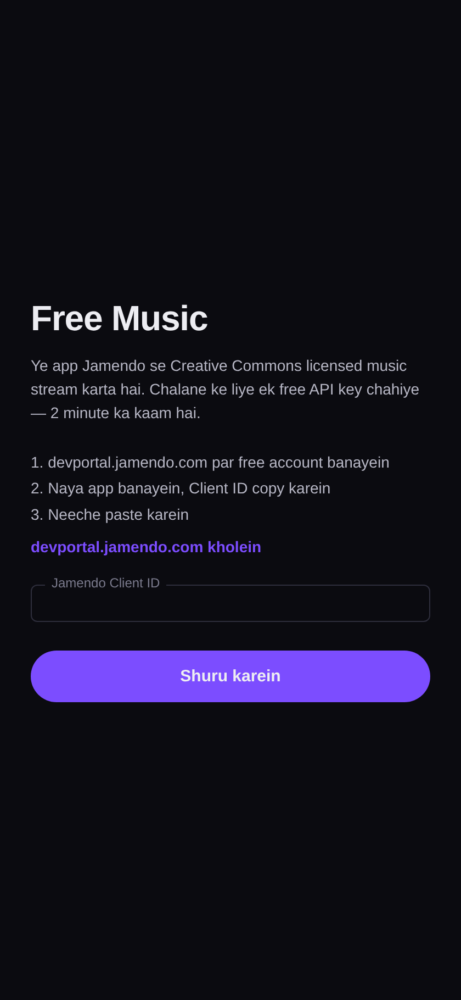

# Free Music — Android music player

Ek chhota, pura chalne wala Android music player jo **Jamendo** se Creative Commons
licensed music stream karta hai. Kotlin + Jetpack Compose + Media3 (ExoPlayer).

> **Legal note:** duniya ke saare commercial gaane (Bollywood / Hollywood) kisi bhi app se
> free nahi chalaye ja sakte — wo catalog licensed hota hai. Ye app sirf wahi music
> bajata hai jo artist ne CC license ke saath share kiya hai, is liye ye 100% legal hai
> aur Play Store ke rules ke andar rehta hai.

## Screenshots

| Browse | Player | First launch |
|---|---|---|
|  |  |  |

_Note: ye UI previews hain jo app ke actual Compose theme (colours, type scale, layout)
se banaye gaye hain — real device screenshots nahi, kyunki build environment mein
emulator nahi tha. App ka UI inhi screens jaisa hai._

## Download

Prebuilt debug APK: [**FreeMusic-1.0.apk**](https://github.com/technicalnihilist-lgtm/free-music-player-android/releases/latest)

Install karne ke liye phone par "Install unknown apps" allow karna padega.
Debug key se signed hai — apna release build banane ke liye neeche dekhein.

## Features

- Jamendo se popular tracks, 80 results tak
- Search — gaana, artist ya album ke naam se
- Genre filter — Pop, Rock, Electronic, Hip-Hop, Jazz, Classical, Ambient, Lounge, World
- Background playback + notification aur lock-screen controls (Media3 MediaSession)
- Play / pause, next / previous, seek bar, shuffle, repeat-all
- Headphones nikalne par auto-pause (audio becoming noisy)
- Mini player + full-screen player with album art
- API key app ke andar daalte hain — code edit karne ki zarurat nahi

## Setup

App pehli baar khulte hi Jamendo API key maangega:

1. [devportal.jamendo.com](https://devportal.jamendo.com/) par free account banayein
2. "Create an app" — plan **Free / Non-commercial**
3. **Client ID** copy karein, app mein paste karein

Free tier ~35,000 requests/month.

## Build

```bash
# JDK 17 + Android SDK 34 chahiye
echo "sdk.dir=/path/to/Android/sdk" > local.properties
./gradlew :app:assembleDebug
# output: app/build/outputs/apk/debug/app-debug.apk
```

Ya Android Studio mein `File > Open` → sync → `Build > Build APK(s)`.

Release build ke liye `Build > Generate Signed Bundle / APK` se apna keystore banayein.

## Tech

| | |
|---|---|
| Language | Kotlin 1.9.24 |
| UI | Jetpack Compose (Material 3), Compose BOM 2024.06.00 |
| Playback | AndroidX Media3 1.3.1 (ExoPlayer + MediaSessionService) |
| Networking | OkHttp 4.12.0, `org.json` |
| Images | Coil 2.6.0 |
| AGP / Gradle | 8.5.2 / 8.7 |
| minSdk / targetSdk | 24 (Android 7.0) / 34 |

## Structure

```
app/src/main/java/com/freemusic/player/
  MainActivity.kt              entry point, notification permission
  data/Jamendo.kt              API call + JSON parsing
  data/Prefs.kt                client id storage (SharedPreferences)
  player/PlaybackService.kt    Media3 background service + notification
  player/PlayerViewModel.kt    MediaController + UI state flow
  ui/App.kt                    Compose UI (setup, browse, mini player, player)
  ui/PlayerIcons.kt            hand-built vector icons (keeps APK small)
  ui/theme/Theme.kt            dark colour scheme
```

## License

Code MIT. Music Jamendo se aata hai aur uske apne CC license ke under rehta hai —
har track ka license URL API response mein `license_ccurl` field se milta hai.
