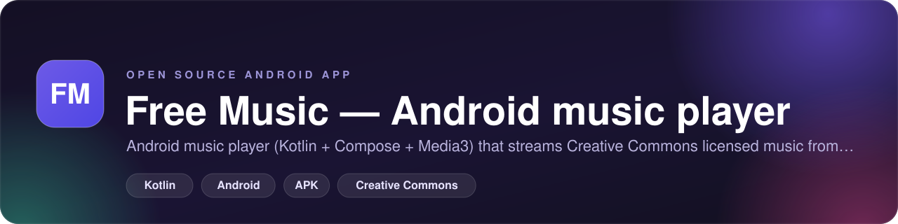
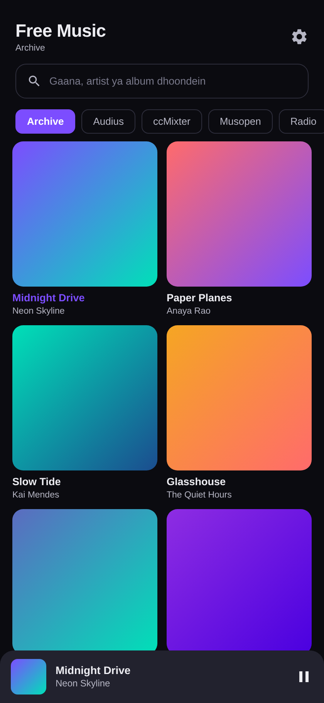
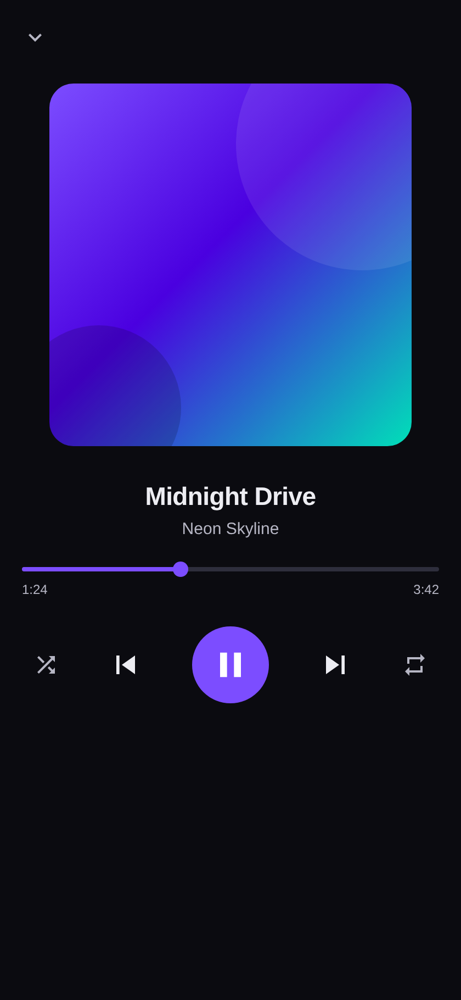

<div align="center">



<a href="https://github.com/technicalnihilist-lgtm/free-music-player-android/stargazers"></a>&nbsp;<a href="https://github.com/technicalnihilist-lgtm/free-music-player-android/network/members"></a>

<a href="https://github.com/technicalnihilist-lgtm/free-music-player-android/releases/latest"></a>

<b>Support the work</b>

  

<sub>Donations aren't live yet — Paytm, UPI, PayPal and Buy&nbsp;Me&nbsp;a&nbsp;Coffee all show <b>coming soon</b>. Until then, a ⭐ star is the best support.</sub>

<a href="https://github.com/technicalnihilist-lgtm/free-music-player-android/releases/latest"></a>  <a href="https://github.com/technicalnihilist-lgtm/free-music-player-android/releases"></a>

</div>

---

## Screenshots

| Browse | Player | 
|---|---|
|  |  |

_Note: ye UI previews hain jo app ke actual Compose theme (colours, type scale, layout)
se banaye gaye hain — real device screenshots nahi, kyunki build environment mein
emulator nahi tha._

## Download

Prebuilt APK: [**FreeMusic-1.7.apk**](https://github.com/technicalnihilist-lgtm/free-music-player-android/releases/latest)

Install karne ke liye phone par "Install unknown apps" allow karna padega.
Debug key se signed hai — apna release build banane ke liye neeche dekhein.

## Music sources

Dono sources **bina kisi API key, bina signup, bina account** ke chalte hain.

| Source | Catalog |
|---|---|
| **Archive** (default) | Public domain aur Creative Commons **music** — netlabels, live concert recordings (etree), 78rpm transfers |
| **Audius** | Open catalog, artists ke apne uploads; trending aur search |

App khulte hi **Archive** load hota hai; upar ke chips se **Audius** par switch kar sakte
hain. Dono jagah 2-column artwork grid, tap karke bajayein.

**Archive ke baare mein:** query sirf music collections tak seemit hai — `netlabels`,
`audio_music`, `etree` (live concerts), `georgeblood`/`78rpm` — aur `librivox`,
`audio_bookspoetry`, `podcasts`, `radioprograms`, `oldtimeradio`, `audio_news` jaise
spoken-word collections explicitly exclude hain. Results downloads ke hisaab se sort hote
hain, taaki grid mein asli music aaye. Listing sasti hai, par asli MP3 ka URL har item ke
andar alag hota hai, is liye audio tap karne par resolve hota hai
(`archive.org/metadata/{id}`), phir player ko diya jaata hai.

**Audius ke baare mein:** read API mein har request par sirf ek `app_name` string jaati
hai. `GET /tracks/{id}/stream` asli audio deti hai un tracks ke liye jinme
`is_streamable` true hai. Audius kai discovery nodes par chalta hai, is liye app 4 known
hosts order se try karta hai.

## Features

- App khulte hi **album artwork ka 2-column grid**
- Do free sources: Archive aur Audius — dono keyless
- Archive par **sirf music** — speeches, audiobooks, podcasts, old radio drama aur
  personal recordings filter ho jaate hain
- Search — gaana, artist ya album ke naam se
- Background playback + notification aur lock-screen controls (Media3 MediaSession)
- Play / pause, next / previous, seek bar, shuffle, repeat-all
- Headphones nikalne par auto-pause
- Mini player + full-screen player with album art

## Build

```bash
## Tech

| | |
|---|---|
| Language | Kotlin 1.9.24 |
| UI | Jetpack Compose (Material 3), Compose BOM 2024.06.00 |
| Playback | AndroidX Media3 1.3.1 (ExoPlayer + MediaSessionService) |
| Networking | OkHttp 4.12.0, `org.json` |
| Images | Coil 2.6.0 |
| AGP / Gradle | 8.5.2 / 8.7 |
| minSdk / targetSdk | 24 (Android 7.0) / 34 |

## Structure

```
app/src/main/java/com/freemusic/player/
  MainActivity.kt              entry point, notification permission
  data/InternetArchive.kt      archive.org music search + lazy MP3 resolution
  data/Audius.kt               Audius API (no key) + node failover
  player/PlaybackService.kt    Media3 background service + notification
  player/PlayerViewModel.kt    MediaController + UI state flow
  ui/App.kt                    Compose UI (artwork grid, mini player, player)
  ui/PlayerIcons.kt            hand-built vector icons (keeps APK small)
  ui/theme/Theme.kt            dark colour scheme
```

Kuch files repo mein padi hain par UI se hata di gayi hain: `data/Jamendo.kt`,
`data/SpotifyAuth.kt`, `data/SpotifyApi.kt`, `data/Prefs.kt`, `data/CcMixter.kt`,
`data/RadioBrowser.kt`. Ye purane releases mein chal rahe the; v1.6 mein sirf Archive aur
Audius expose hain.

## Changelog

**v1.7** — Poora naya UI: "liquid glass" design. Ambient gradient blobs, glass surfaces,
hero heading, segmented source control, gloss artwork cards with a play badge (playing
card par animated equalizer), glass mini player with a progress line, aur naya
now-playing screen. Note: Android mein true backdrop-blur nahi hota, is liye glass
translucent surfaces + gradient hairlines se approximate kiya gaya hai.

**v1.6** — Sirf Archive aur Audius (ccMixter, Musopen, Radio hata diye — wo chal nahi rahe
the). Archive ki query ab music-only hai: sirf netlabel/music/live-concert/78rpm
collections, spoken-word collections excluded, aur downloads ke hisaab se sorted. Results
60 se 100 kar diye.

**v1.5** — Paanch keyless sources: Archive, Audius, ccMixter, Musopen (archive.org ka
`musopen` collection), aur Radio Browser. Jamendo aur Spotify UI se bahar rakhe gaye.

**v1.4** — Sirf do keyless sources: Internet Archive (default) aur Audius. Jamendo aur
Spotify UI se hata diye (code repo mein hai). App khulte hi artwork grid.

**v1.3** — Artwork grid home screen; Internet Archive source add hua.

**v1.2** — Spotify source: PKCE login, catalog search, play on active Spotify device.

**v1.1** — Audius source added (keyless, default).

**v1.0** — Pehla working build: Jamendo streaming, search, genres, background playback.

## License

Code MIT. Music apne respective platform ke terms ke under aata hai — Internet Archive
par public domain / CC items, Audius par artist ke apne uploads.

---

---

## 🌍 Languages

<sub>Donations are <b>coming soon</b> in every language below — nothing to pay today, nothing to click.</sub>

<div align="center">

<sub><b>हिन्दी · বাংলা · मराठी · తెలుగు · தமிழ் · ગુજરાતી · ಕನ್ನಡ · മലയാളം · ਪੰਜਾਬੀ · ଓଡ଼ିଆ · অসমীয়া · اردو</b></sub>

</div>

<details>
<summary><b>🌍 Open the same message in 53 languages</b></summary>

**🇮🇳 Indian languages**

- **हिन्दी** (Hindi) — ☕ जल्द ही आ रहा है। · ⭐ अगर आपको यह ऐप और हमारा काम पसंद है, तो कृपया रिपॉजिटरी को स्टार दें और हमें फॉलो करें।
- **বাংলা** (Bengali) — ☕ খুব শিগগিরই আসছে। · ⭐ যদি আপনার এই অ্যাপ এবং আমাদের কাজ ভালো লাগে, তবে অনুগ্রহ করে রিপোজিটরিটিকে একটি স্টার দিন এবং আমাদের ফলো করুন।
- **मराठी** (Marathi) — ☕ लवकरच येत आहे. · ⭐ जर तुम्हाला हे ॲप आणि आमचं काम आवडलं असेल, तर कृपया रिपॉझिटरीला स्टार द्या आणि आम्हाला फॉलो करा.
- **తెలుగు** (Telugu) — ☕ త్వరలో రాబోతోంది. · ⭐ మీకు ఈ యాప్, మా పని నచ్చితే, దయచేసి రిపోజిటరీకి ఒక స్టార్ ఇచ్చి మమ్మల్ని ఫాలో అవ్వండి.
- **தமிழ்** (Tamil) — ☕ விரைவில் வருகிறது. · ⭐ உங்களுக்கு இந்த ஆப்பும் எங்க வேலையும் பிடிச்சிருந்தா, தயவுசெஞ்சு இந்த ரெபாசிட்டரிக்கு ஒரு ஸ்டார்…
- **ગુજરાતી** (Gujarati) — ☕ ટૂંક સમયમાં આવી રહ્યું છે. · ⭐ જો તમને આ એપ અને અમારું કામ ગમતું હોય, તો પ્લીઝ રિપોઝિટરીને સ્ટાર આપો અને અમને ફોલો કરો.
- **ಕನ್ನಡ** (Kannada) — ☕ ಶೀಘ್ರದಲ್ಲೇ ಬರುತ್ತಿದೆ. · ⭐ ನಿಮಗೆ ಈ ಆ್ಯಪ್ ಮತ್ತು ನಮ್ಮ ಕೆಲಸ ಇಷ್ಟವಾದರೆ, ದಯವಿಟ್ಟು ರೆಪೊಸಿಟರಿಗೆ ಸ್ಟಾರ್ ಕೊಡಿ ಮತ್ತು ನಮ್ಮನ್ನು ಫಾಲೋ ಮಾಡಿ.
- **മലയാളം** (Malayalam) — ☕ ഉടൻ വരുന്നു. · ⭐ നിങ്ങൾക്ക് ഈ ആപ്പും ഞങ്ങളുടെ പ്രവർത്തനവും ഇഷ്ടപ്പെട്ടെങ്കിൽ, ദയവായി റെപ്പോസിറ്ററിക്ക് ഒരു സ്റ്റാർ…
- **ਪੰਜਾਬੀ** (Punjabi) — ☕ ਜਲਦੀ ਆ ਰਿਹਾ ਹੈ। · ⭐ ਜੇ ਤੁਹਾਨੂੰ ਇਹ ਐਪ ਅਤੇ ਸਾਡਾ ਕੰਮ ਪਸੰਦ ਹੈ, ਤਾਂ ਕਿਰਪਾ ਕਰਕੇ ਰਿਪੋਜ਼ਟਰੀ ਨੂੰ ਸਟਾਰ ਦਿਓ ਅਤੇ ਸਾਨੂੰ ਫਾਲੋ ਕਰੋ।
- **ଓଡ଼ିଆ** (Odia) — ☕ ଖୁବ୍ ଶୀଘ୍ର ଆସୁଛି। · ⭐ ଯଦି ଆପଣଙ୍କୁ ଏହି ଆପ୍ ଏବଂ ଆମର କାମ ଭଲ ଲାଗୁଛି, ତେବେ ଦୟାକରି ରିପୋଜିଟୋରୀକୁ ଗୋଟିଏ ଷ୍ଟାର୍ ଦିଅନ୍ତୁ ଏବଂ ଆମକୁ ଫଲୋ କରନ୍ତୁ।
- **অসমীয়া** (Assamese) — ☕ অতি সোনকালেই আহি আছে। · ⭐ যদি আপুনি এই এপটো আৰু আমাৰ কাম ভাল পায়, তেন্তে অনুগ্ৰহ কৰি ৰিপজিটৰীটোক এটা ষ্টাৰ দিয়ক আৰু আমাক ফ'ল' কৰক।
- **اردو** (Urdu) — ☕ جلد آرہا ہے۔ · ⭐ اگر آپ کو یہ ایپ اور ہمارا کام پسند آئے تو براہ کرم ریپازٹری کو سٹار دیں اور ہمیں فالو کریں۔
- **संस्कृतम्** (Sanskrit) — ☕ शीघ्रमेव आगच्छति।
- **मैथिली** (Maithili) — ☕ जल्दिये आबि रहल अछि।
- **कोंकणी** (Konkani) — ☕ रोखडेंच येता.
- **کٲشُر** (Kashmiri) — ☕ جَلدی یِوان چھُ۔
- **سنڌي** (Sindhi) — ☕ जल्द अची रह्यो आहे।
- **डोगरी** (Dogri) — ☕ जल्दी आ करदा ऐ।
- **ꯃꯤꯇꯩ ꯂꯣꯟ** (Manipuri) — ☕ ꯑꯊꯨꯕꯥ ꯃꯇꯝꯗꯥ ꯂꯥꯛꯀꯅꯤ꯫
- **बर’** (Bodo) — ☕ थाबैनो फैगोन।
- **ᱥᱟᱱᱛᱟᱲᱤ** (Santali) — ☕ ᱞᱚᱜᱚᱱ ᱦᱤᱡᱩᱜ ᱠᱟᱱᱟ᱾
- **नेपाली** (Nepali) — ☕ छिट्टै आउँदैछ। · ⭐ यदि तपाईंलाई यो एप र हाम्रो काम मन पर्‍यो भने, कृपया रिपोजिटरीलाई स्टार दिनुहोस् र हामीलाई फलो गर्नुहोस्।

**🌍 World languages**

- **العربية** (Arabic) — ☕ قريبًا. · ⭐ إذا أعجبك هذا التطبيق وعملنا، فيرجى منح المستودع نجمة ومتابعتنا.
- **简体中文** (Chinese (Simplified)) — ☕ 即将推出。
- **繁體中文** (Chinese (Traditional)) — ☕ 即將推出。
- **Čeština** (Czech) — ☕ Již brzy.
- **Dansk** (Danish) — ☕ Kommer snart.
- **Nederlands** (Dutch) — ☕ Binnenkort beschikbaar. · ⭐ Vind je deze app en ons werk leuk?
- **Filipino** (Filipino) — ☕ Malapit na.
- **Suomi** (Finnish) — ☕ Tulossa pian.
- **Français** (French) — ☕ Bientôt disponible. · ⭐ Si cette application et notre travail vous plaisent, mettez une étoile au dépôt et suivez-nous.
- **Deutsch** (German) — ☕ Bald verfügbar. · ⭐ Wenn dir diese App und unsere Arbeit gefallen, gib dem Repository einen Stern und folge uns.
- **Ελληνικά** (Greek) — ☕ Έρχεται σύντομα.
- **עברית** (Hebrew) — ☕ בקרוב.
- **Magyar** (Hungarian) — ☕ Hamarosan.
- **Bahasa Indonesia** (Indonesian) — ☕ Segera hadir. · ⭐ Jika kamu suka aplikasi ini dan karya kami, beri bintang pada repositori ini dan ikuti kami.
- **Italiano** (Italian) — ☕ In arrivo.
- **日本語** (Japanese) — ☕ 近日公開。 · ⭐ このアプリと私たちの仕事が気に入ったら、リポジトリにスターを付けてフォローしてください。
- **한국어** (Korean) — ☕ 곧 공개됩니다. · ⭐ 이 앱과 저희 작업이 마음에 드신다면 저장소에 스타를 눌러 주시고 팔로우해 주세요.
- **Bahasa Melayu** (Malay) — ☕ Akan datang.
- **Norsk** (Norwegian) — ☕ Kommer snart.
- **فارسی** (Persian) — ☕ به‌زودی.
- **Polski** (Polish) — ☕ Wkrótce. · ⭐ Jeśli podoba Ci się ta aplikacja i nasza praca, daj repozytorium gwiazdkę i obserwuj nas.
- **Português** (Portuguese) — ☕ Em breve.
- **Română** (Romanian) — ☕ În curând.
- **Русский** (Russian) — ☕ Скоро. · ⭐ Если вам нравится это приложение и наша работа, поставьте звёздочку репозиторию и подпишитесь на нас.
- **Español** (Spanish) — ☕ Muy pronto. · ⭐ Si te gusta esta app y nuestro trabajo, dale una estrella al repositorio y síguenos.
- **Kiswahili** (Swahili) — ☕ Inakuja hivi karibuni.
- **Svenska** (Swedish) — ☕ Kommer snart.
- **ไทย** (Thai) — ☕ เร็ว ๆ นี้
- **Türkçe** (Turkish) — ☕ Çok yakında.
- **Українська** (Ukrainian) — ☕ Незабаром.
- **Tiếng Việt** (Vietnamese) — ☕ Sắp ra mắt. · ⭐ Nếu bạn thích ứng dụng này và công việc của chúng tôi, hãy tặng kho lưu trữ một ngôi sao và theo…

</details>

